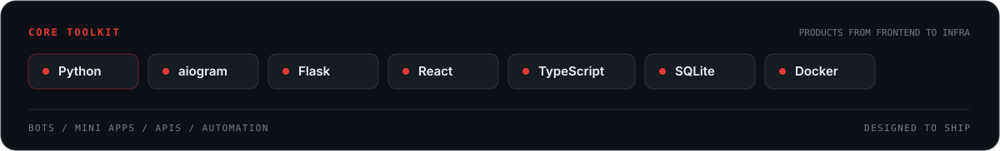

  

  

  <a href="https://github.com/fertfert">GitHub · @fertfert</a>
  &nbsp; / &nbsp; Python · AI · Product

## About

Hey, I’m Timur — a Python / AI Product Builder. I turn practical ideas into software people can use: Telegram bots and Mini Apps, APIs, and automation.

My product work includes **CARTEX**, for AI-assisted analysis of used cars, and **AI agents** built around useful workflows. I enjoy taking a problem from a rough idea to a clear, working product.

## Selected projects

  

AI-assisted analysis for the used-car market, shaped around clear, useful vehicle insights.

## Stack

  

## GitHub stats

  

Public figures · refreshed daily from GitHub

## Contribution trail

  

The local SVG keeps this section available while GitHub Actions refreshes the contribution animation.

  Built with care · Timur · <a href="https://github.com/fertfert">@fertfert</a>

